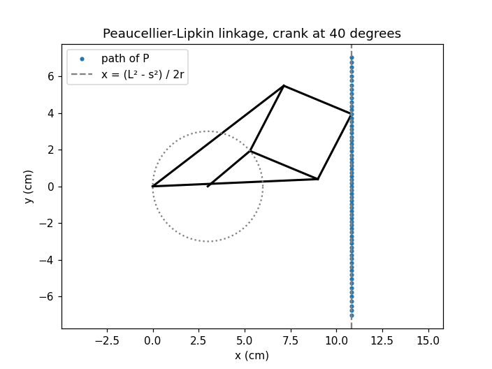

# Peaucellier-Lipkin Mechanism Analysis in ADAMS

An eight-bar linkage that turns the rotation of a crank into an exact straight line using only
pin joints, modelled and analysed in ADAMS.

Course project, Mechanism Simulation and Synthesis (ME 7001), IIT Bombay, Mar 2026.
Guide: Prof. Anirban Guha.

## What I did

- Modelled the eight-bar Peaucellier-Lipkin straight-line linkage in ADAMS and checked its
  kinematics and link trajectories.
- Chose link lengths of 3, 9 and 4 cm by trial so that they meet the linkage's conditions for
  exact straight-line motion.
- Ran static force analyses at crank angles of 45, 30, 0 and -15 degrees for the joint forces,
  the member loads and the holding torque.
- Ran dynamic analyses under constant and sinusoidal input torques and compared the velocity and
  acceleration profiles.

## Link lengths

| Link | Length |
|---|---|
| Fixed link, between the two fixed pivots | 3 cm |
| Crank | 3 cm |
| Two long links, from a fixed pivot to two corners of the rhombus | 9 cm each |
| Four sides of the rhombus | 4 cm each |

Counting the fixed link, that is eight links. These lengths meet the conditions for exact
straight-line motion. The two long links are equal, the four sides of the rhombus are equal, and
the crank is as long as the fixed link.

## Why the line is straight

A fixed pivot O is joined to two corners A and B of a rhombus by two equal long links (L). The
rhombus has side s, and its other two corners are C (on the crank) and P (the output). O, C and
P always stay on one line and

```
OC x OP = L^2 - s^2
```

so P is the inverse of C. The crank turns about a second fixed pivot at a distance r from O, and
it is also r long, so it keeps C on a circle that passes through O. The inverse of such a circle
is a straight line, at `x = (L^2 - s^2) / 2r`.

With L = 9 cm, s = 4 cm and r = 3 cm, OC x OP = 65 cm² and the line sits at x = 65/6 = 10.83 cm
from O.

## linkage.py

The ADAMS model files are not in this repo. `linkage.py` is a short Python check of the geometry
above, written in 2026 for this repo, after the course. It is separate from the ADAMS model but
uses the same link lengths. For crank angles from -66 to 66 degrees, in steps of 2 degrees, it
finds the joint positions and checks that P stays on the line. With these lengths the crank
cannot turn past about 67 degrees either way, because the rhombus folds flat there.

```
$ python3 linkage.py
expected line: x = 10.833 cm
largest deviation of P from it: 5.3e-15 cm
P moves from y = -7.0 to 7.0 cm
```


